# Gameplay HUD & Game Interface Redesign

The gameplay interface is one presentation layer built on top of the existing
game session: the Three.js viewport, movement, camera, worlds, social, voice,
inventory and editing code were not replaced. Everything the player sees while
inside a world now comes from `src/hud/`, with pure decisions in
`shared/hud-presentation.mjs`.

- **Branch:** `feat/gameplay-hud-redesign`
- **Scope:** client presentation and HUD state only. No backend, database,
  protocol, permission or save-format changes.
- **Screenshots:** [artifacts/hud](../artifacts/hud) — six device presentations
  plus menu, social, editing and contextual states.

## 1. What changed

| Before | After |
| --- | --- |
| Top bar with brand, Play Online/Local, Exit, diagnostics, display toggles | Compact floating pill: world, floor/items, presence or `Solo`, voice, chat, menu (desktop app adds a window bar) |
| Permanent bottom dock with Walk/Edit plus a `LOOK` strip | One joystick (touch), camera drag on the world, contextual action cluster, editing panel replaces the cluster |
| Scattered action and camera buttons | One contextual cluster: primary action + compact utility actions + Camera/Emote popovers |
| SocialHud panel opened from a top utility button | Dark social sheet opened from chat or the menu; the gameplay controls fade out while it is open |
| Settings spread across the shell | One light central game menu with Map, World, Social, Friends, Messages, Inventory, Character, Emotes, Settings, Leave world |
| Old green-glow control skin | Neutral charcoal/frosted HUD with white icons; green only for the brand dot, selected marker and live status |

## 2. Architecture

```
shared/hud-presentation.mjs      pure presentation + HUD state + context prompt rules
src/hud/GameInterface.tsx        orchestrator: state, primary action, layout choice
src/hud/presentation.ts          presentation types + helper
src/hud/layouts/TouchHud.tsx     phone/tablet composition
src/hud/layouts/DesktopHud.tsx   desktop browser/app composition
src/hud/Joystick.tsx             one analog stick -> touchInput (same path as WASD)
src/hud/ActionCluster.tsx        primary + utility actions, labels, press/disabled states
src/hud/ActionLayer.tsx          sprint, jump, emote, camera popover
src/hud/popovers.tsx             camera/emote menus
src/hud/TopHud.tsx               floating pill (browser) or full-width app bar (installed)
src/hud/VoiceControl.tsx         voice range, push-to-talk, live mic card
src/hud/Notifications.tsx        compact toasts
src/hud/GameMenu.tsx             central light menu (all sections + settings)
src/hud/SocialPanel.tsx          dark chat/people/party/friends/shop/worlds sheet
src/hud/BuildPanel.tsx           editing catalog/surfaces/layouts/selection
src/hud/primitives.tsx           buttons, pills, sheets, focus rings
src/index.css                    `--ll-*` tokens + `.ll-*` surfaces, motion, a11y rules
```

Device detection is unchanged (`shared/device-platform.mjs`). The HUD only
consumes its result:

- touch presentation for phone, tablet, APK, iOS shell and mobile browsers
- desktop presentation for desktop web, PWA and the Windows app
- installed desktop adds a window-like top bar with fullscreen control
- hybrid devices still switch presentation with the last input without resetting
  the camera

## 3. HUD states

`hudStateFor()` derives one state; layouts render only that state's controls.

| State | Controls | Gameplay input |
| --- | --- | --- |
| Exploration | Joystick + Camera/Emote/Sprint/Jump | active |
| Nearby interaction | Same + primary action (`Open`, `Sit`, `Use`, `Unlock`, …) with key hint | active |
| Social (sheet open) | Social sheet only; joystick/actions unmounted | suppressed |
| Chat | Chat sheet only; movement/action cluster hidden | suppressed (typing safe) |
| Menus/settings | Central menu, no HUD | suppressed, camera state kept |
| Editing | Build panel (catalog, surfaces, layouts, selection, done) | build input only |
| Vehicle | While `session.riding` (LoftLine transit), the ride layer replaces walking controls | active |

Rendering state is mirrored on the DOM for tests: `[data-hud="top"]`,
`[data-hud="joystick"]`, `[data-hud="actions"]`, `[data-hud="build"]`.

## 4. Six presentations

| Presentation | Layout choices |
| --- | --- |
| Mobile portrait | 132 px stick lower-left, 4-action stack lower-right, compact pill top, 44 px targets, safe-area insets |
| Mobile landscape | Stick lower-left, 2×2 action grid lower-right, single-line top pill, controls clear of system gesture edges |
| Tablet portrait | Larger labeled actions on the right, stick lower-left, social shortcut rail above the stick, extra breathing room |
| Tablet landscape | Same zones with wider spacing and labels; world stays dominant |
| Desktop browser | No touch controls; floating status pill, labeled action cluster lower-right, keyboard/mouse |
| Desktop app | Full-width installed-app bar (brand, location, status, window/fullscreen, menu), larger action scale, no browser chrome dependence |

The layouts share primitives and state, but compose them per class and
orientation instead of reflowing a single component.

## 5. Controls preserved

- WASD/arrow walking, Shift sprint, Space jump, E interact, R voice range,
  T microphone, C chat, Z zoom, M/C map, Escape closes menu/modal.
- Isometric click/tap-to-move, Play View third-person movement, 360° orbit,
  follow camera, zoom and camera modes are untouched.
- Touch: one stick writes the same `touchInput` singleton as the keyboard;
  dragging the world orbits (no permanent LOOK strip); the Camera popover
  carries follow/zoom/view.
- Voice: range cycling, push-to-talk, mic status and the advanced device/mic
  test panel remain reachable from the menu.
- Editing: the full catalog, surfaces, layouts and placement flow are exposed
  through the build panel and `BuildController`.
- World travel, permissions, account state, offline-first saves and mobile
  browser gameplay are unchanged.

## 6. Menu

One entry point in the top HUD opens a light sheet:

- **Explore** — Map (live suite/city mini-map), World (travel, permissions,
  furnish, manage world).
- **Social** — Social sheet, Friends/requests/party, Messages.
- **You** — Inventory, Character, Emotes.
- **System** — Settings (camera, lighting, controls, touch size/handedness,
  audio & voice, graphics, accessibility, display/window), Leave world.

Opening the menu hides the HUD, stops world input, keeps camera state, and
Escape/✕ restores exactly the previous state. Developer diagnostics are no
longer in the player HUD; with `?hudDebug` the presentation and state are
exposed for inspection.

## 7. Guests, hotel and airport

The HUD merged with the guest-city, airport and hotel rollout on `main`. It
reads the same session state as the rest of the game instead of keeping a
parallel copy:

- `session.status === 'guest'` marks a guest visit. `hudSectionAvailable()` and
  `hudChatScopesFor()` in `shared/hud-presentation.mjs` decide which menu
  sections and chat tabs exist, so guests keep Map, World, Social, Inventory,
  Character, Emotes, Settings and Leave, plus nearby and city chat, while
  Friends, direct messages and party chat stay account-only.
- The social sheet shows `Guest Visit · <name>`, hides the wallet, shop, worlds
  and daily-reward controls, and cannot open the worlds browser. The shop is
  read-only for guests at the airport clothing counter.
- A guest's home is the device-local guest room, not a resident suite. The
  elevator, keycard and intercom panels receive the server-allocated suite
  number and floor for registered players.
- Travel stays physical, matching `main`: suite and hallway doors lead through
  the hotel, and TheCity is left at the airport departure desk. The game menu
  deliberately offers no city/suite teleport and no separate leave-city button.
- Menu → World → Furnish still opens the build panel; opening the menu, chat or
  the social sheet still unmounts movement and action controls.

Verified locally with a registered account on the SQLite API: dashboard entry,
suite HUD, all menu sections, editing, and the contextual hotel `Unlock`
action. The local Node API does not implement `/api/guest/session` (only the
Cloudflare Worker does), so the live guest path could not be run in this
workspace; guest gating is covered by unit tests and the build/Worker checks.

## 8. Accessibility

- Every icon control has an `aria-label`; selected/toggled controls use
  `aria-pressed`/`aria-current`.
- Touch targets are 44 px minimum (primary action 70 px).
- Frosted surfaces keep text contrast; status uses icon + text, not colour alone.
- Visible `:focus-visible` rings on all interactive HUD elements.
- System reduced-motion and reduced-transparency are honoured, plus explicit
  Large text, High contrast, Reduce motion and Control opacity settings.
- Gameplay input is suppressed while the menu, social sheet or a text field is
  active; movement keys ignore inputs.

## 9. Verification

Run in this workspace against the redesigned UI:

| Check | Result |
| --- | --- |
| `npx tsc --noEmit` | pass |
| `npm test` (server/shared) | 109/109 pass, including 8 HUD presentation tests |
| `npm run build` | pass (Vite; pre-existing chunk-size warning only) |
| `npx wrangler deploy --dry-run` | pass — Worker + 17 static assets bundle, Durable Object and ASSETS bindings intact |
| Dev server + desktop browser (1440×900) | account dashboard → suite enters, top HUD and action cluster render, no console errors beyond a favicon 404 and WebGL perf warnings |
| Contextual action | walked into the studio stool radius: primary `Sit on Studio Stool`, `S`/`E` hint, key path fires the same interaction; in TheCity the hotel door reports `Unlock` |
| Game menu | all 10 sections reachable; Settings toggles camera, touch size, handedness, audio, graphics |
| Social sheet | opens from chat; joystick/actions absent from DOM while open |
| Editing | menu → World → Furnish this suite mounts the build panel and unmounts walking controls |
| Mobile portrait (390×844) | iOS UA, gameplay allowed, `touch` input, stick + action stack inside viewport, no overlap |
| Mobile landscape (844×390) | 2×2 actions, stick, top pill; joystick drag moved the avatar **2.91 m**; canvas drag orbited without opening a menu or action |
| Tablet portrait (820×1180) | labeled actions, social rail, stick, no overlap |
| Tablet landscape (1180×820) | labeled actions, rail, stick, no overlap |
| Desktop app (Windows bridge) | `windows-exe`, installed bar, fullscreen control, keyboard/mouse HUD |
| Orientation change | portrait ↔ landscape resized live without layout breakage |

Not verified here: physical iOS/Android/tablet hardware and notch insets,
vehicle controls with a live city/transit nearby, real fullscreen windowing,
a live multiplayer session, and automated visual regression. Safe-area padding
is implemented with `env(safe-area-inset-*)` but emulation reports zero insets.
The dev preview has no backend, so world travel/permissions and voice were not
re-exercised.

## 10. Screenshots

| | |
| --- | --- |
| Desktop browser | 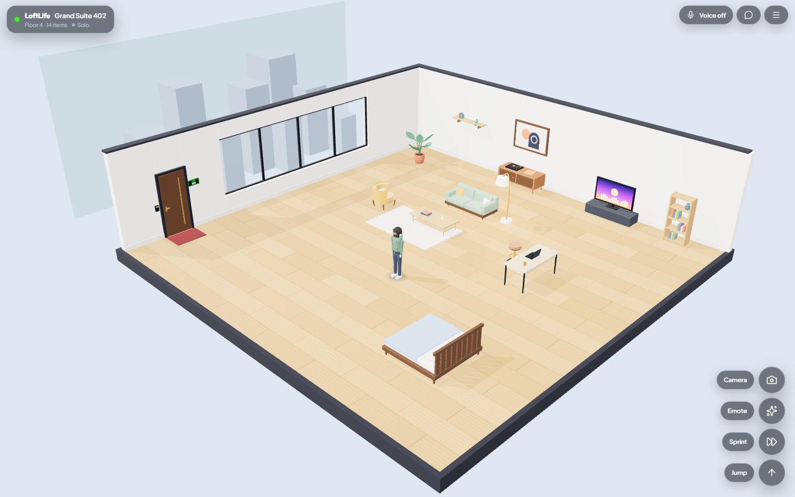 |
| Desktop app | 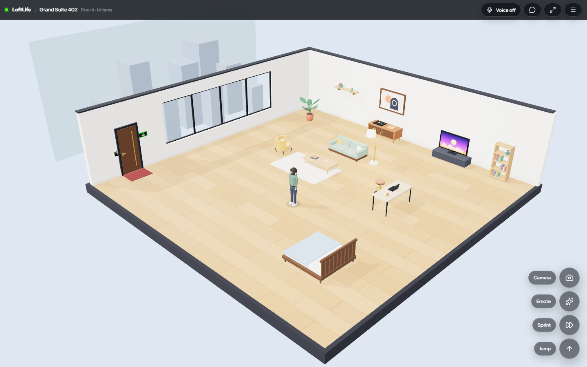 |
| Mobile portrait | 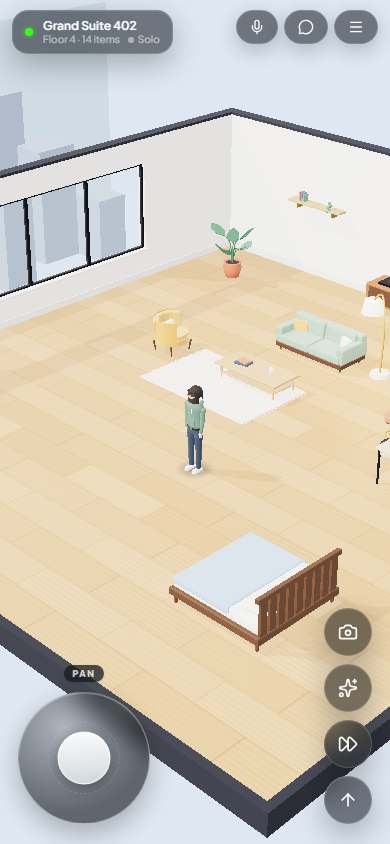 |
| Mobile landscape | 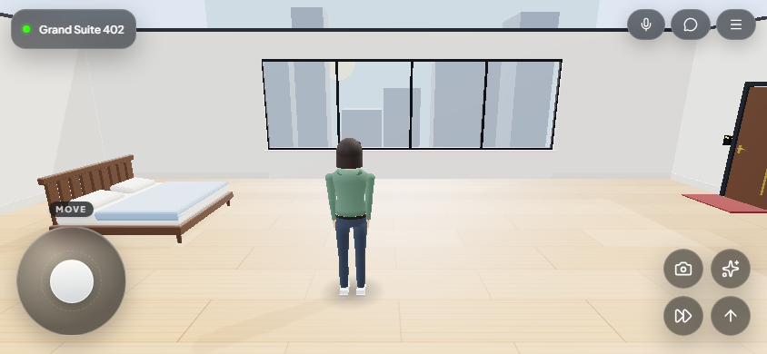 |
| Tablet portrait | 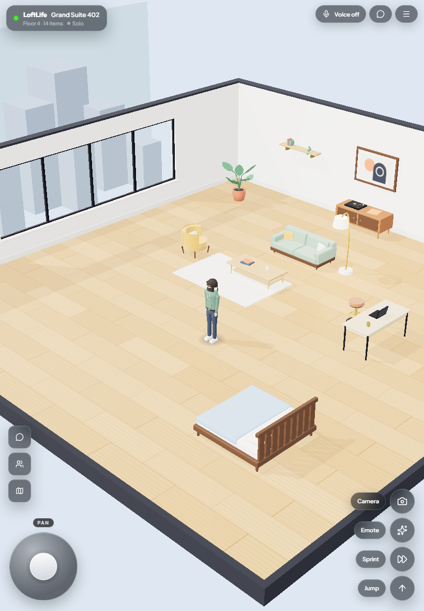 |
| Tablet landscape | 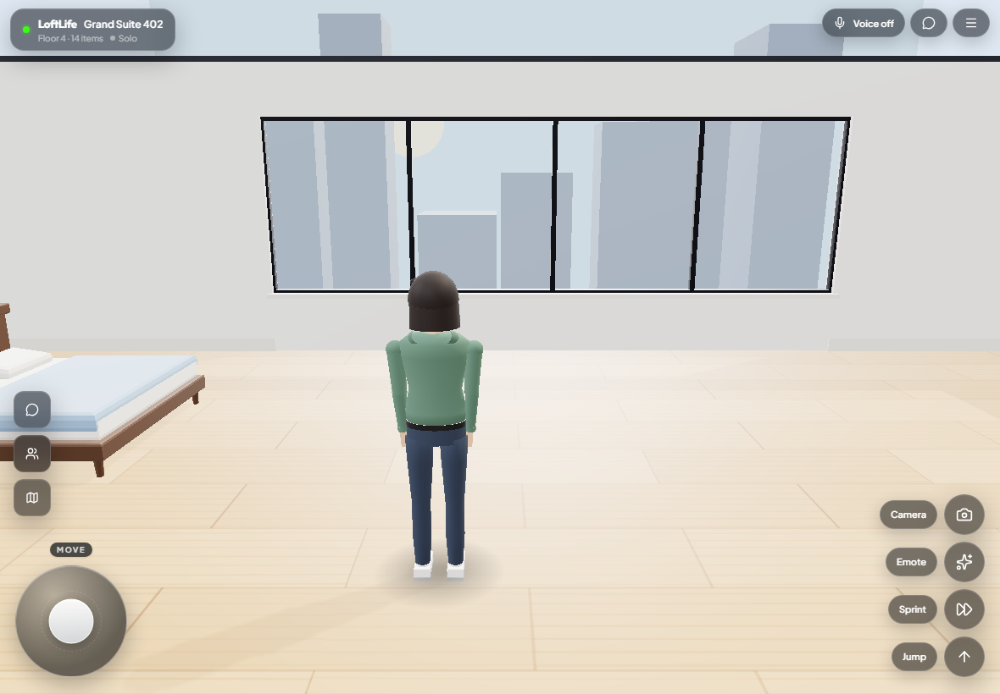 |
| Contextual action | 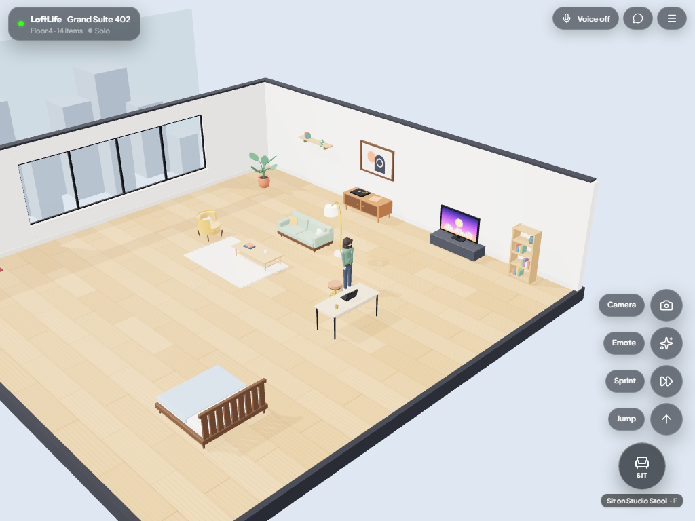 |
| Central menu | 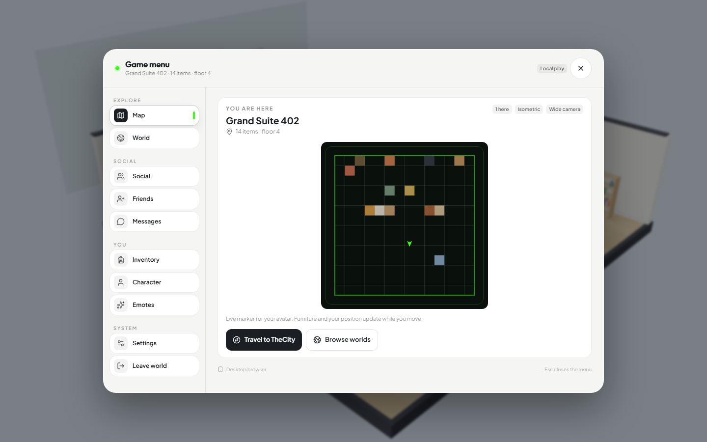 |
| Menu on mobile | 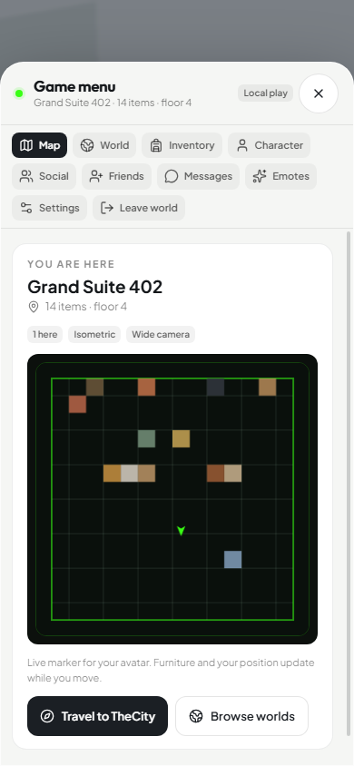 |
| Social sheet | 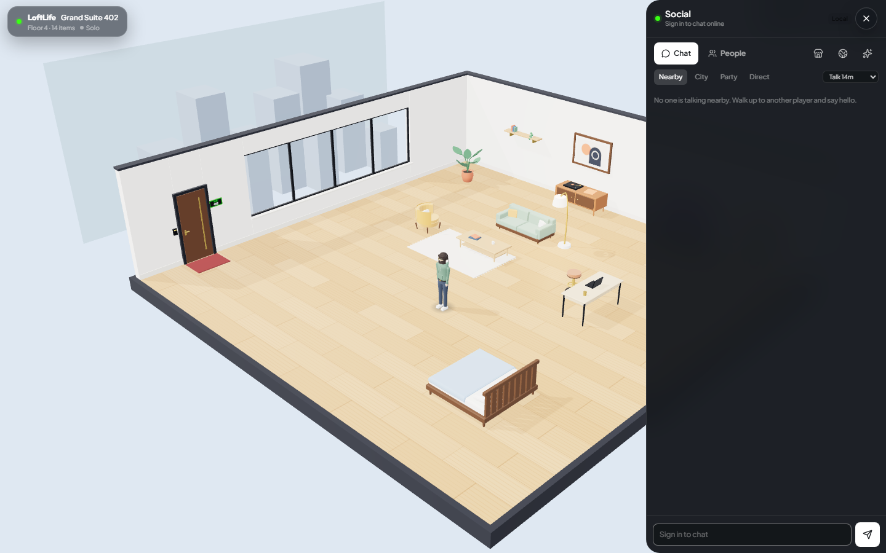 |
| Audio & voice settings | 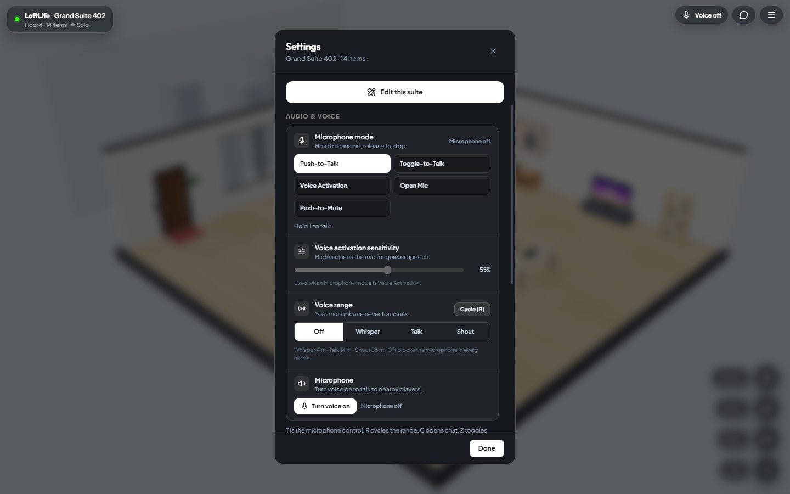 |
| Editing state | 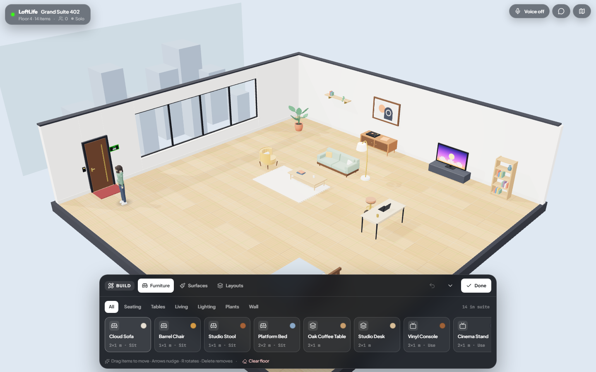 |
